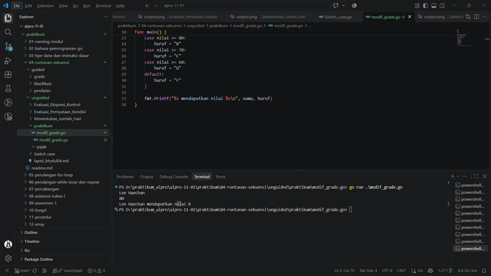
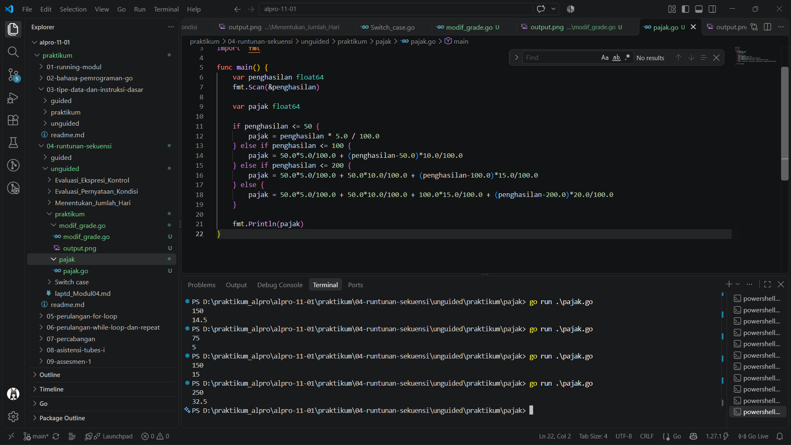

# <h1 align="center">Laporan Praktikum Modul 04 - Runtunan/Sekuensi</h1>
<p align="center">Rafiq Khairan Putra Permana - 109092600008</p>

## Dasar Teori

### A. Percabangan
Percabangan memungkinkan program memilih instruksi yang dijalankan berdasarkan kondisi. Dalam Go, `if`, `else if`, dan `else` dapat digunakan untuk memeriksa beberapa rentang nilai secara berurutan. Bentuk `switch` juga dapat digunakan untuk memilih satu kondisi dari beberapa kemungkinan.

### B. Operator Perbandingan dan Aritmetika
Operator perbandingan seperti `>=` dan `<=` menghasilkan nilai boolean yang digunakan sebagai kondisi percabangan. Operator aritmetika seperti `+`, `-`, dan `*` digunakan untuk menghitung nilai. Pada perhitungan pajak progresif, setiap tarif dikenakan pada bagian penghasilan di rentang terkait, bukan pada seluruh penghasilan.

### C. Input dan Output
Package `fmt` menyediakan fungsi untuk membaca masukan dan menampilkan hasil. `fmt.Scan` membaca nilai dari masukan standar, sedangkan `fmt.Println` dan `fmt.Printf` menampilkan keluaran. Package `bufio` dan `os` digunakan bersama untuk membaca satu baris nama, sementara `strings.TrimSpace` menghapus karakter spasi atau baris baru di awal dan akhir nama.

## Praktikum

### 1. Menentukan Nilai Huruf

```go
package main

import (
	"bufio"
	"fmt"
	"os"
	"strings"
)

func main() {
	reader := bufio.NewReader(os.Stdin)

	nama, _ := reader.ReadString('\n')
	nama = strings.TrimSpace(nama)

	var nilai float64
	fmt.Fscan(reader, &nilai)

	var huruf string
	switch {
	case nilai >= 90:
		huruf = "A"
	case nilai >= 80:
		huruf = "B"
	case nilai >= 70:
		huruf = "C"
	case nilai >= 60:
		huruf = "D"
	default:
		huruf = "F"
	}

	fmt.Printf("%s mendapatkan nilai %s\n", nama, huruf)
}
```

##### Output


#### Deskripsi
Program membaca nama pada satu baris dan nilai numerik pada baris berikutnya. Nilai bertipe `float64` diperiksa menggunakan `switch`: nilai minimal 90 mendapat A, minimal 80 mendapat B, minimal 70 mendapat C, minimal 60 mendapat D, dan nilai di bawah 60 mendapat F. Program kemudian menampilkan nama dan nilai huruf menggunakan `fmt.Printf`.

### 2. Menghitung Pajak Penghasilan

```go
package main

import "fmt"

func main() {
	var penghasilan float64
	fmt.Scan(&penghasilan)

	var pajak float64

	if penghasilan <= 50 {
		// 5% dari seluruh penghasilan
		pajak = penghasilan * 5.0 / 100.0
	} else if penghasilan <= 100 {
		// 5% x 50 + 10% x (penghasilan - 50)
		pajak = 50.0*5.0/100.0 + (penghasilan-50.0)*10.0/100.0
	} else if penghasilan <= 200 {
		// 5% x 50 + 10% x 50 + 15% x (penghasilan - 100)
		pajak = 50.0*5.0/100.0 + 50.0*10.0/100.0 + (penghasilan-100.0)*15.0/100.0
	} else {
		// 5% x 50 + 10% x 50 + 15% x 100 + 20% x (penghasilan - 200)
		pajak = 50.0*5.0/100.0 + 50.0*10.0/100.0 + 100.0*15.0/100.0 + (penghasilan-200.0)*20.0/100.0
	}

	fmt.Println(pajak)
}
```

##### Output


#### Deskripsi
Program membaca penghasilan sebagai `float64`, lalu menghitung pajak dengan tarif bertingkat menggunakan `if`, `else if`, dan `else`. Bagian penghasilan sampai 50 dikenai 5%, bagian di atas 50 sampai 100 dikenai 10%, bagian di atas 100 sampai 200 dikenai 15%, dan sisanya di atas 200 dikenai 20%. Pajak dari setiap lapisan dijumlahkan, kemudian hasilnya ditampilkan.

## Kesimpulan
Melalui praktikum Modul 04, saya mempraktikkan penggunaan percabangan untuk menentukan keluaran berdasarkan nilai masukan. Pernyataan `switch` digunakan untuk mengelompokkan nilai ke dalam predikat huruf, sedangkan `if` dan `else if` digunakan untuk menghitung pajak secara progresif berdasarkan rentang penghasilan. Pembacaan input dan pemilihan kondisi yang tepat membantu program menghasilkan keluaran sesuai aturan.

## Referensi
1. The Go Team. (n.d.). *Go Documentation*. https://go.dev/doc/
2. The Go Team. (n.d.). *A Tour of Go*. https://go.dev/tour/
