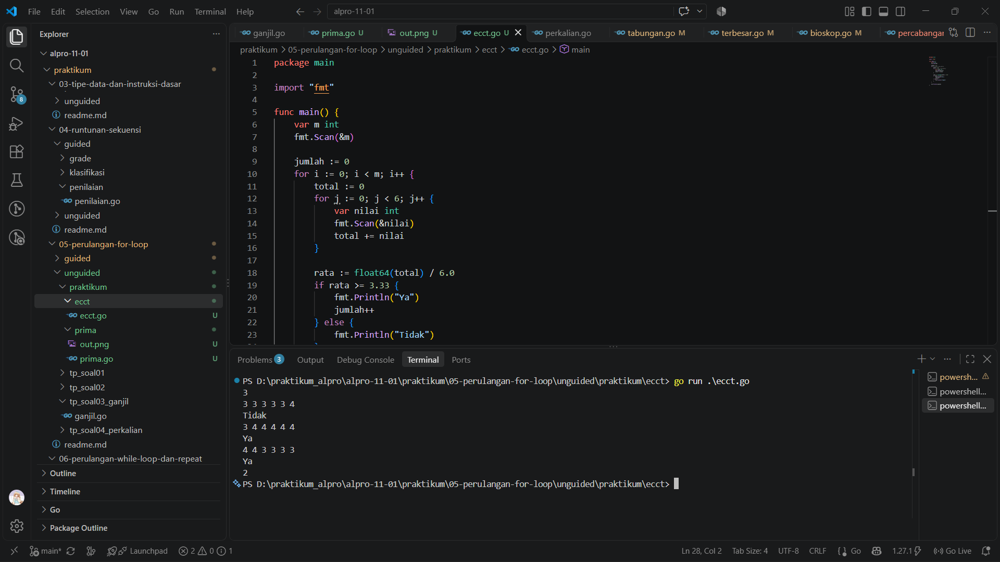
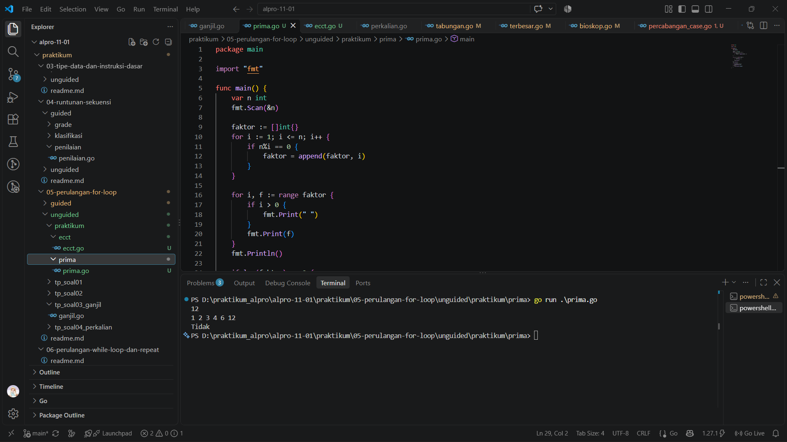

# <h1 align="center">Laporan Praktikum Modul 05 - Perulangan For Loop</h1>
<p align="center">Rafiq Khairan Putra Permana - 109092600008</p>

## Dasar Teori

### A. Perulangan `for`
Perulangan digunakan untuk menjalankan suatu blok kode berulang kali. Go menggunakan kata kunci `for` untuk berbagai kebutuhan perulangan. Bentuk `for` dengan tiga komponen terdiri atas inisialisasi, kondisi, dan post statement. Inisialisasi dijalankan sekali sebelum perulangan, kondisi diperiksa sebelum setiap iterasi, dan post statement dijalankan setelah badan perulangan selesai.

```go
for i := 0; i < jumlah; i++ {
	// kode yang diulang
}
```

### B. Perulangan Bersarang
Perulangan bersarang adalah perulangan yang berada di dalam badan perulangan lain. Perulangan luar dapat memproses beberapa data atau peserta, sedangkan perulangan dalam memproses sejumlah nilai untuk setiap peserta. Setiap perulangan memiliki variabel pengulang dan kondisi masing-masing.

### C. Akumulator dan Kondisi
Akumulator menyimpan hasil penjumlahan atau jumlah kejadian selama perulangan berlangsung. Nilainya diperbarui pada setiap iterasi, misalnya `total += nilai` untuk menjumlahkan nilai dan `jumlah++` untuk menghitung banyak data yang memenuhi kondisi. Pernyataan `if` dapat digunakan di dalam perulangan untuk menentukan tindakan berdasarkan hasil perhitungan.

### D. Faktor dan Bilangan Prima
Faktor dari suatu bilangan adalah bilangan yang membagi habis bilangan tersebut. Operator sisa bagi `%` dapat digunakan untuk memeriksa apakah suatu bilangan merupakan faktor: jika `n%i == 0`, maka `i` adalah faktor dari `n`. Bilangan prima memiliki tepat dua faktor positif, yaitu 1 dan bilangan itu sendiri.

## Praktikum

### 1. Menghitung Peserta yang Memenuhi Kriteria ECCT

```go
package main

import "fmt"

func main() {
	var m int
	fmt.Scan(&m)

	jumlah := 0
	for i := 0; i < m; i++ {
		total := 0
		for j := 0; j < 6; j++ {
			var nilai int
			fmt.Scan(&nilai)
			total += nilai
		}

		rata := float64(total) / 6.0
		if rata >= 3.33 {
			fmt.Println("Ya")
			jumlah++
		} else {
			fmt.Println("Tidak")
		}
	}

	fmt.Println(jumlah)
}
```

##### Output


#### Deskripsi
Program membaca jumlah peserta `m`, kemudian membaca enam nilai untuk setiap peserta. Perulangan bersarang digunakan untuk menjumlahkan keenam nilai tersebut. Rata-rata dihitung dengan mengubah total menjadi `float64` lalu membaginya dengan 6. Jika rata-rata minimal 3,33, program mencetak `Ya` dan menambah akumulator `jumlah`; jika tidak, program mencetak `Tidak`. Setelah semua peserta diproses, program menampilkan jumlah peserta yang memenuhi kriteria.

### 2. Menentukan Faktor dan Bilangan Prima

```go
package main

import "fmt"

func main() {
	var n int
	fmt.Scan(&n)

	faktor := []int{}
	for i := 1; i <= n; i++ {
		if n%i == 0 {
			faktor = append(faktor, i)
		}
	}

	for i, f := range faktor {
		if i > 0 {
			fmt.Print(" ")
		}
		fmt.Print(f)
	}
	fmt.Println()

	if len(faktor) == 2 {
		fmt.Println("Ya")
	} else {
		fmt.Println("Tidak")
	}
}
```

##### Output


#### Deskripsi
Program membaca bilangan `n`, lalu menggunakan perulangan dari 1 sampai `n` untuk mencari faktor dengan memeriksa sisa bagi `n%i`. Setiap faktor disimpan ke dalam slice `faktor`. Perulangan `range` menampilkan semua faktor dengan pemisah spasi. Selanjutnya, program mencetak `Ya` jika jumlah faktor tepat dua, yang menunjukkan bahwa `n` adalah bilangan prima; jika jumlahnya bukan dua, program mencetak `Tidak`.

## Kesimpulan
Melalui praktikum Modul 05, saya mempelajari penggunaan perulangan `for` untuk memproses data secara berulang. Perulangan bersarang membantu mengolah beberapa nilai untuk setiap peserta, sedangkan akumulator digunakan untuk menghitung total dan banyak peserta yang memenuhi kriteria. Perulangan juga dapat digunakan untuk mencari faktor bilangan, yang kemudian dimanfaatkan untuk menentukan apakah suatu bilangan termasuk bilangan prima.

## Referensi
1. The Go Team. (n.d.). *Go Documentation*. https://go.dev/doc/
2. The Go Team. (n.d.). *A Tour of Go*. https://go.dev/tour/
