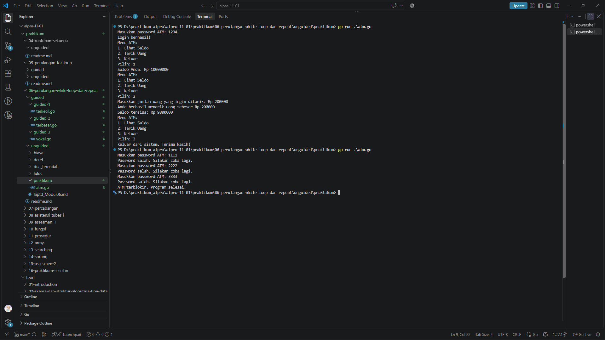

# <h1 align="center">Laporan Praktikum Modul 06 - Perulangan While Loop dan Repeat</h1>
<p align="center">Rafiq Khairan Putra Permana - 109092600008</p>

## Dasar Teori

### A. Perulangan While Loop
Perulangan while menjalankan suatu blok instruksi selama kondisi bernilai benar. Go tidak memiliki kata kunci `while` secara khusus, sehingga perulangan while ditulis menggunakan `for` dengan kondisi.

```go
for kondisi {
	// instruksi yang diulang
}
```

Kondisi diperiksa sebelum setiap iterasi. Ketika kondisi bernilai salah, perulangan berhenti.

### B. Perulangan Repeat
Perulangan repeat menjalankan instruksi berulang sampai kondisi berhenti terpenuhi. Pola ini dapat dibuat di Go menggunakan `for` tanpa kondisi dan dihentikan dengan `break`.

```go
for {
	// instruksi yang diulang
	if kondisiBerhenti {
		break
	}
}
```

### C. Penggunaan Kondisi dan Penghitung
Kondisi dapat menggabungkan beberapa syarat menggunakan operator logika, seperti `&&`. Variabel penghitung dapat membatasi jumlah pengulangan, misalnya untuk menentukan berapa kali pengguna boleh mencoba memasukkan password. Variabel status seperti boolean juga dapat digunakan untuk mengatur kapan perulangan berakhir.

## Praktikum

### 1. Program ATM

```go
package main

import "fmt"

func main() {
	const passwordBenar = "1234"
	const maksKesempatan = 3

	saldo := 10000000
	kesempatan := 0
	login := false

	for !login && kesempatan < maksKesempatan {
		var password string
		fmt.Print("Masukkan password ATM: ")
		if _, err := fmt.Scan(&password); err != nil {
			fmt.Println("Input tidak valid. Program selesai.")
			return
		}

		if password == passwordBenar {
			login = true
		} else {
			kesempatan++
			fmt.Println("Password salah. Silakan coba lagi.")
		}
	}

	if !login {
		fmt.Println("ATM terblokir. Program selesai.")
		return
	}

	fmt.Println("Login berhasil!")

	pilihan := 0
	for pilihan != 3 {
		fmt.Println("Menu ATM:")
		fmt.Println("1. Lihat Saldo")
		fmt.Println("2. Tarik Uang")
		fmt.Println("3. Keluar")
		fmt.Print("Pilih: ")
		if _, err := fmt.Scan(&pilihan); err != nil {
			fmt.Println("Input tidak valid. Program selesai.")
			return
		}

		if pilihan == 1 {
			fmt.Println("Saldo Anda: Rp", saldo)
		} else if pilihan == 2 {
			var jumlah int
			fmt.Print("Masukkan jumlah uang yang ingin ditarik: Rp ")
			if _, err := fmt.Scan(&jumlah); err != nil {
				fmt.Println("Input tidak valid. Program selesai.")
				return
			}

			if jumlah <= 0 {
				fmt.Println("Jumlah penarikan harus lebih dari 0.")
			} else if jumlah <= saldo {
				saldo -= jumlah
				fmt.Println("Anda berhasil menarik uang sebesar Rp", jumlah)
				fmt.Println("Saldo tersisa: Rp", saldo)
			} else {
				fmt.Println("Saldo tidak mencukupi")
			}
		} else if pilihan == 3 {
			fmt.Println("Keluar dari sistem. Terima kasih!")
		} else {
			fmt.Println("Pilihan tidak valid.")
		}
	}
}
```

##### Output


#### Deskripsi
Program ATM meminta password dan memberi pengguna maksimal tiga kesempatan untuk masuk. Perulangan `for !login && kesempatan < maksKesempatan` berjalan selama login belum berhasil dan kesempatan masih tersedia. Jika password benar, program menampilkan menu ATM; jika tiga kali salah, program menampilkan pesan bahwa ATM terblokir.

Setelah login berhasil, perulangan `for pilihan != 3` terus menampilkan menu sampai pengguna memilih keluar. Pilihan pertama menampilkan saldo, sedangkan pilihan kedua meminta jumlah penarikan. Penarikan hanya berhasil jika jumlahnya lebih dari nol dan tidak melebihi saldo. Pilihan selain menu yang tersedia ditolak. Program juga berhenti dengan pesan yang jelas apabila pembacaan input gagal.

## Kesimpulan
Pada praktikum Modul 06, perulangan `for` di Go dapat digunakan sebagai while loop dengan kondisi, maupun sebagai perulangan berulang yang berhenti berdasarkan kondisi tertentu. Pada program ATM, while loop membatasi percobaan login dan menjaga menu tetap ditampilkan sampai pengguna memilih keluar. Kondisi, penghitung, dan status login membantu mengendalikan alur program.

## Referensi
1. The Go Team. (n.d.). *Go Documentation*. https://go.dev/doc/
2. The Go Team. (n.d.). *A Tour of Go*. https://go.dev/tour/
