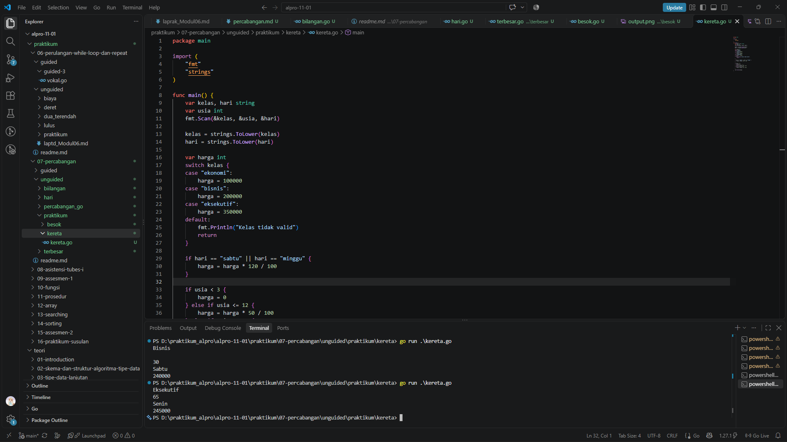
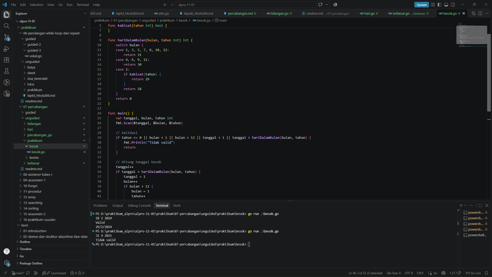

# <h1 align="center">Laporan Praktikum Modul 07 - Percabangan</h1>
<p align="center">Rafiq Khairan Putra Permana - 109092600008</p>

## Dasar Teori

### A. Percabangan `if`, `else if`, dan `else`
Percabangan adalah mekanisme yang memungkinkan program menjalankan blok instruksi tertentu berdasarkan kondisi tertentu. Dalam Go, struktur percabangan umum ditulis sebagai berikut:

```go
if kondisi {
	// blok jika kondisi benar
} else if kondisiLain {
	// blok jika kondisi lain benar
} else {
	// blok jika semua kondisi salah
}
```

Kondisi dalam percabangan biasanya berupa ekspresi boolean, seperti perbandingan `>`, `<`, `==`, `!=`, atau kombinasi dengan operator logika `&&` dan `||`.

### B. Percabangan `switch`
`switch` digunakan ketika program harus memilih satu dari beberapa kemungkinan berdasarkan nilai tertentu. Struktur ini lebih rapi dibandingkan banyak `else if` bertingkat.

```go
switch nilai {
case kondisi1:
	// aksi 1
case kondisi2:
	// aksi 2
default:
	// aksi default
}
```

Go juga mendukung `switch` tanpa ekspresi, sehingga tiap `case` dapat berisi kondisi boolean.

### C. Penerapan Percabangan dalam Program
Percabangan sering digunakan untuk validasi data, menentukan harga, menghitung diskon, dan memeriksa apakah tanggal benar. Dengan kombinasi `if` dan `switch`, program dapat menjalankan logika yang berbeda sesuai input pengguna.

## Praktikum

### 1. Program Harga Tiket Kereta

```go
package main

import (
	"fmt"
	"strings"
)

func main() {
	var kelas, hari string
	var usia int
	fmt.Scan(&kelas, &usia, &hari)

	kelas = strings.ToLower(kelas)
	hari = strings.ToLower(hari)

	var harga int
	switch kelas {
	case "ekonomi":
		harga = 100000
	case "bisnis":
		harga = 200000
	case "eksekutif":
		harga = 350000
	default:
		fmt.Println("Kelas tidak valid")
		return
	}

	if hari == "sabtu" || hari == "minggu" {
		harga = harga * 120 / 100
	}

	if usia < 3 {
		harga = 0
	} else if usia <= 12 {
		harga = harga * 50 / 100
	} else if usia >= 60 {
		harga = harga * 70 / 100
	}

	fmt.Println(harga)
}
```

##### Output


#### Deskripsi
Program ini membaca kelas kereta, usia penumpang, dan hari keberangkatan. Nilai `kelas` diproses dengan `switch` untuk menentukan harga dasar. Jika hari yang dipilih adalah Sabtu atau Minggu, maka harga akan naik 20%.

Setelah itu, program mengecek usia penumpang menggunakan `if`, `else if`, dan `else` untuk menerapkan diskon. Penumpang usia di bawah 3 tahun mendapat harga 0, anak-anak sampai 12 tahun mendapat diskon 50%, dan penumpang berusia 60 tahun ke atas mendapat diskon 70%. Jika input kelas tidak valid, program langsung berhenti dan menampilkan pesan `Kelas tidak valid`.

### 2. Program Menentukan Tanggal Besok

```go
package main

import "fmt"

func kabisat(tahun int) bool {
	return (tahun%4 == 0 && tahun%100 != 0) || tahun%400 == 0
}

func hariDalamBulan(bulan, tahun int) int {
	switch bulan {
	case 1, 3, 5, 7, 8, 10, 12:
		return 31
	case 4, 6, 9, 11:
		return 30
	case 2:
		if kabisat(tahun) {
			return 29
		}
		return 28
	}
	return 0
}

func main() {
	var tanggal, bulan, tahun int
	fmt.Scan(&tanggal, &bulan, &tahun)

	if tahun <= 0 || bulan < 1 || bulan > 12 || tanggal < 1 || tanggal > hariDalamBulan(bulan, tahun) {
		fmt.Println("Tidak valid")
		return
	}

	tanggal++
	if tanggal > hariDalamBulan(bulan, tahun) {
		tanggal = 1
		bulan++
		if bulan > 12 {
			bulan = 1
			tahun++
		}
	}

	fmt.Println("Valid")
	fmt.Printf("%d/%d/%d\n", tanggal, bulan, tahun)
}
```

##### Output


#### Deskripsi
Program membaca tanggal, bulan, dan tahun dari input. Pertama-tama, program memeriksa apakah tanggal yang dimasukkan valid dengan menggunakan `if`. Jika bulan tidak ada dalam rentang 1 sampai 12, tahun tidak valid, atau tanggal di luar jumlah hari bulan terkait, maka program menampilkan `Tidak valid` dan berhenti.

Jika data valid, program menambah satu hari dengan percabangan. Jika tanggal bertambah melebihi jumlah hari dalam bulan saat ini, maka tanggal direset menjadi 1 dan bulan bertambah satu. Jika bulan melebihi 12, bulan diubah menjadi 1 dan tahun bertambah satu. Akhirnya, program menampilkan tanggal berikutnya dengan format `tanggal/bulan/tahun` dan menandai hasil valid dengan `Valid`.

## Kesimpulan
Pada praktikum Modul 07, saya mempelajari bahwa percabangan sangat penting untuk mengambil keputusan dalam program. Struktur `if`, `else if`, `else`, dan `switch` digunakan untuk mengecek kondisi tertentu dan memilih tindakan yang sesuai. Penerapan percabangan pada program tiket kereta dan tanggal besok menunjukkan bahwa logika program dapat menyesuaikan hasil berdasarkan input pengguna secara tepat dan efisien.

## Referensi
1. The Go Team. (n.d.). *Go Documentation*. https://go.dev/doc/
2. The Go Team. (n.d.). *A Tour of Go*. https://go.dev/tour/
